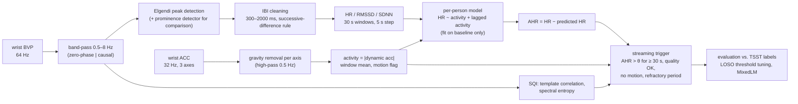
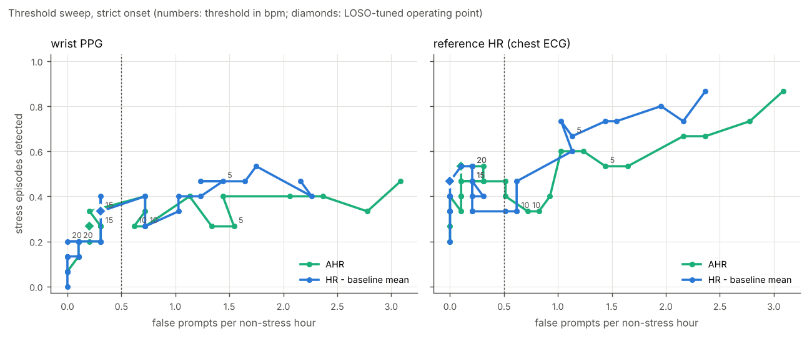
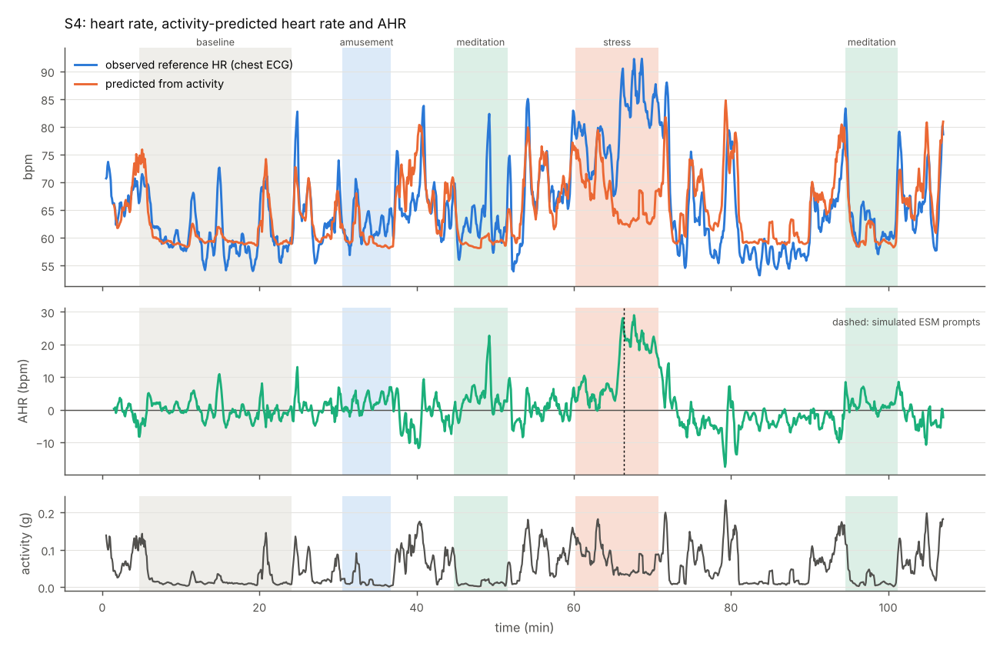
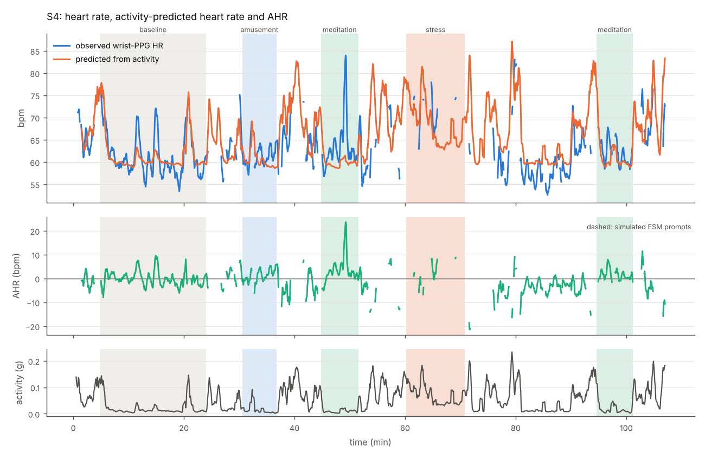
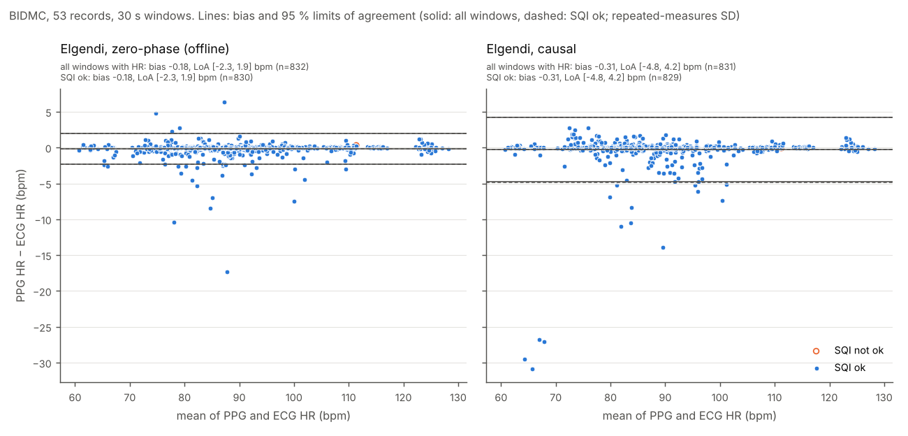
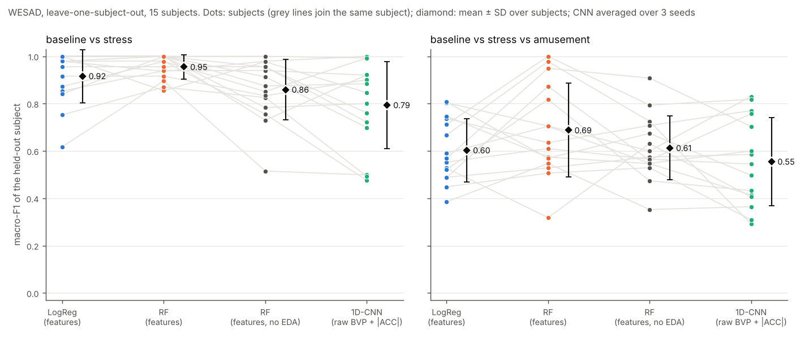

# ahr-stress-trigger

**Additional heart rate (AHR) estimation and a simulated real-time ESM trigger on wrist PPG + accelerometry (public WESAD dataset).**

Wearable stress detection often starts from heart rate, but heart rate is driven mostly by
physical activity: in everyday life, walking up a staircase raises HR far more than a stressful
e-mail does. A trigger that fires on raw HR therefore mostly detects movement. The
*additional heart rate* idea (Myrtek, 2004) is to predict, per person, the heart rate that the
current physical activity explains, and to treat only the remainder, **AHR = HR − HR̂(activity)**,
as a candidate psychological signal. AHR can then trigger an experience-sampling (ESM) prompt
or a just-in-time intervention in daily life.

This repository implements that chain end to end on public data, with every step that a
real-time system would run implemented causally (past data only):



## Quick start

```bash
pip install -e ".[test]"          # Python >= 3.11; numpy, scipy, pandas, statsmodels, matplotlib
pytest                            # unit tests on synthetic signals, no download needed (CNN tests need torch)

python scripts/run_all.py --synthetic        # whole pipeline on synthetic subjects -> results/synthetic/
python scripts/download_wesad.py             # official WESAD download (~2.1 GB) + compact local cache in data/
python scripts/run_all.py                    # whole pipeline on WESAD -> results/  (~10 min)

pip install -e ".[validation]"               # + NeuroKit2 (pinned) for the BIDMC cross-check
python scripts/download_bidmc.py             # PhysioNet BIDMC v1.0.0 (~33 MB) -> data/bidmc/
python scripts/run_bidmc.py                  # PPG vs ECG validation -> results/bidmc/  (~20 s)

pip install torch --index-url https://download.pytorch.org/whl/cpu   # CPU-only wheel (optional, smaller)
pip install -e ".[dl]"                       # torch + scikit-learn for the deep baseline
python scripts/run_cnn.py                    # 1D-CNN vs features on WESAD, LOSO -> results/cnn/
```

`data/` is git-ignored. **No WESAD or BIDMC file and no per-sample derived data is committed**;
`results/` holds only aggregated tables and figures.

## Repository layout

| Path | Content |
|---|---|
| `src/ahr/io_wesad.py` | WESAD loader: wrist BVP/ACC/EDA/TEMP as tidy frames with time index and label (time-aligned to the 700 Hz label stream); compact cache |
| `src/ahr/ppg.py` | detrending, Butterworth band-pass (zero-phase and causal + streaming class), analytic and measured group delay, Elgendi and prominence peak detectors, IBI cleaning, interpolation, windowed HR / RMSSD / SDNN |
| `src/ahr/sqi.py` | beat-template correlation and spectral-entropy SQIs per window |
| `src/ahr/motion.py` | per-axis gravity removal, activity magnitude, motion flag |
| `src/ahr/pipeline.py` | raw signals -> per-window feature table (offline or causal) |
| `src/ahr/ahr.py` | per-person activity -> HR model, AHR |
| `src/ahr/trigger.py` | streaming ESM trigger simulator |
| `src/ahr/evaluate.py` | trigger metrics, threshold sweep, LOSO tuning, MixedLM |
| `src/ahr/ecg.py` | chest-ECG R-peak detector, used **only** as a heart-rate reference |
| `src/ahr/synthetic.py` | synthetic PPG + accelerometer with known ground truth |
| `src/ahr/io_bidmc.py` | BIDMC loader (WFDB format 16, no `wfdb` dependency) |
| `src/ahr/validation.py` | PPG–ECG delay, one-to-one beat matching, repeated-measures Bland–Altman |
| `src/ahr/windows.py` | 60 s classification windows, calibration-only z-scoring, LOSO / inner splits, macro-F1, balanced accuracy |
| `src/ahr/cnn.py` | small 1D-CNN and training loop (optional `[dl]` extra) |
| `scripts/` | `download_wesad.py`, `run_all.py`, `download_bidmc.py`, `run_bidmc.py`, `run_cnn.py` |
| `results/` | aggregated results of the WESAD run (`results/synthetic/`: synthetic run, `results/bidmc/`: BIDMC validation, `results/cnn/`: deep baseline) |

## Methods in brief

**Data.** WESAD (Schmidt et al., 2018): 15 participants, lab protocol with baseline (~20 min),
TSST stress (~10 min), amusement and guided meditation, ~1.5–1.8 h per session. Only the wrist
device (Empatica E4) is used by the pipeline: BVP 64 Hz and ACC 32 Hz (converted from 1/64 g to g).
Labels (700 Hz) are aligned by time. The chest ECG is used only to validate wrist HR and as an
"ideal HR sensor" reference condition for the trigger (see below).

**PPG.** 2nd-order Butterworth band-pass 0.5–8 Hz, forward-backward (offline) or forward only
(causal). Systolic peaks with the two-moving-average detector of Elgendi et al. (2013); in causal
mode the averages are trailing and a beat only becomes available when its block ends. A
`scipy.signal.find_peaks` prominence detector is computed for comparison. IBIs outside
300–2000 ms or deviating > 25 % from the median of the last 5 accepted IBIs are rejected (past-only,
so usable in streaming). HR, RMSSD and SDNN are computed in trailing 30 s windows every 5 s; a
window needs valid IBIs covering ≥ 50 % of it.
*E4 polarity:* detection runs on the sign-inverted E4 BVP, which gave more physiologically
plausible IBIs in all 15 subjects (mean share of accepted IBIs 0.76 vs 0.66).

**Signal quality.** A window is usable when beat-template correlation ≥ 0.8 (offline) / ≥ 0.7
(causal; the causal filter's non-linear phase distorts the pulse shape) and spectral entropy
≤ 0.75. Thresholds were chosen by comparing wrist HR with chest-ECG HR (see *Parameters*).

**Motion.** Gravity is removed from each accelerometer axis separately (0.5 Hz high-pass)
*before* taking the vector magnitude; the window mean of that magnitude is the activity measure,
and windows above 0.1 g are flagged as motion. (Taking `|acc| − 1 g` first under-estimates motion
orthogonal to gravity; `tests/test_sqi_motion.py` demonstrates this.)

**AHR.** Per participant, `HR(t) = b0 + b1·A(t) + c1·A(t−30 s) + c2·A(t−60 s)` is fitted by least
squares with non-negative activity slopes on the usable *baseline* windows only, then applied to
the whole recording; `AHR = HR − predicted HR`. The comparison score "HR − baseline" is the same
pipeline without activity correction (`HR − mean baseline HR`).

**Trigger.** Windows are replayed in time order. A prompt fires when the score exceeds θ for
≥ 30 s, on a usable (quality OK, no motion) window, at least 20 min after the previous prompt.
Unusable windows pause a run for up to 60 s instead of resetting it; a usable window at or below θ
ends it. Tests verify that decisions never change when future data are altered.

**Evaluation.** A stress episode (label 2) is a *hit* if a prompt falls between its onset and
5 min after its end; *false prompts* are prompts during baseline, amusement or meditation, per hour
spent in those conditions; prompts during unlabelled time (transitions, questionnaires, walking
between rooms) are reported separately. θ is tuned **leave-one-subject-out**: for each held-out
participant, the θ with the highest hit rate among those keeping ≤ 0.5 false prompts/h on the
other 14 is applied to the held-out participant. Condition effects are tested with
`statsmodels` MixedLM, `outcome ~ condition + (1 | subject)`, on per-subject condition means of
usable windows (offline features).

## Results (WESAD, 15 participants)

All numbers below are produced by `python scripts/run_all.py` and stored in `results/`.

### 1. The wrist PPG fails exactly when HR rises

| Condition | windows with wrist HR | usable (SQI OK) | motion flag | wrist vs ECG HR, MAE (usable windows) | MAE (all windows with HR) |
|---|---|---|---|---|---|
| baseline | 95 % | 81 % | 4 % | 1.1 bpm | 1.4 bpm |
| stress (TSST) | 41 % | **23 %** | 24 % | 3.7 bpm | 5.7 bpm |
| amusement | 88 % | 78 % | 0 % | 1.2 bpm | 1.5 bpm |
| meditation | 87 % | 86 % | 0 % | 0.9 bpm | 1.0 bpm |

(`results/signal_quality.csv`, offline features, windows ≥ 95 % within one condition.) During
the TSST participants stand, speak and gesture; the E4 BVP is dominated by artefacts while the
chest ECG shows heart rates of up to ~125 bpm in some participants. The surviving wrist windows
are biased towards calmer moments, so the wrist under-estimates the stress response. Elgendi and
the prominence detector agree within 0.2 bpm (median absolute difference) outside stress and
1.2 bpm during stress.

### 2. Condition effects (MixedLM, random intercept per subject)

| Outcome | stress − baseline [95 % CI] | amusement − baseline | meditation − baseline |
|---|---|---|---|
| wrist HR | **+17.6 bpm** [11.5, 23.8] | −0.2 [−5.9, 5.5] | −2.1 [−7.8, 3.6] |
| wrist AHR | **+15.3 bpm** [9.1, 21.5] | +0.4 [−5.4, 6.1] | −1.5 [−7.3, 4.3] |
| chest-ECG HR (reference) | **+25.5 bpm** [18.7, 32.2] | +0.4 [−6.3, 7.2] | −2.3 [−9.0, 4.4] |
| chest-ECG AHR (reference) | **+22.8 bpm** [15.9, 29.6] | +1.3 [−5.5, 8.1] | −1.0 [−7.9, 5.8] |

(`results/mixedlm_effects.csv`, full output in `results/mixedlm.txt`. Each outcome is averaged
over the windows in which its own signal is usable; for stress, only 12 of 15 participants have any
usable wrist window, against 15 for the ECG.) The TSST produces a large HR increase in WESAD.
The wrist estimate (+17.6 bpm) is smaller than the ECG estimate (+25.5 bpm) because usable wrist
windows are the calmer moments of the TSST; restricted to those same windows, the ECG gives
+21.6 bpm (`hr_ecg_ppg_windows` in `results/mixedlm_effects.csv`). About 2.5 bpm of the increase is attributed to movement (participants stand and
gesture during the TSST; mean activity 0.05 g vs 0.03 g at baseline), so AHR is slightly
smaller than raw HR.
Baseline AHR is ~0 by construction (it is the calibration period); amusement and meditation are
out-of-sample and also stay near 0. RMSSD/SDNN from the wrist are reported in
`results/condition_summary.csv` but are not interpretable during stress (artefacts inflate them).

The per-person activity slopes fitted on baseline alone are positive but noisy: median
45 bpm/g (ECG HR; range 10–134) and 34 bpm/g (wrist HR; range 0–204), with baseline R² of only
0.18 / 0.06, because participants barely move during the baseline (`results/model_coefficients.csv`).

### 3. Simulated ESM trigger (LOSO, refractory 20 min, strict onset)

| Trigger score | stress episodes hit | false prompts / non-stress h | prompts / h in unlabelled time | median latency | LOSO θ (median) |
|---|---|---|---|---|---|
| AHR, wrist PPG | 4/15 (27 %) | 0.21 | 0.86 | 9.6 min | 13 bpm |
| HR − baseline, wrist PPG | 5/15 (33 %) | 0.31 | 0.86 | 9.4 min | 13 bpm |
| AHR, chest-ECG HR (reference) | 8/15 (53 %) | 0.10 | 0.60 | 7.0 min | 21 bpm |
| HR − baseline, chest-ECG HR (reference) | 7/15 (47 %) | 0.00 | 0.69 | 6.7 min | 21 bpm |



*Sweep pooled over all participants (not LOSO), threshold annotated in bpm; the dotted line is the
0.5 false prompts/h budget used for LOSO tuning. Curves are not monotone because a prompt fired
earlier (e.g. in anticipation of the TSST) blocks later prompts through the refractory period.*

Sensitivity analyses (`results/loso_sensitivity.csv`):

* **Anticipation.** Many "misses" are prompts that fire in the minutes *before* the labelled TSST
  onset, while participants are briefed and walk to the TSST room (visible in the per-subject
  figures); they then block the onset through the refractory period. Counting prompts up to 10 min before onset as hits gives 8/15 (AHR) and 11/15
  (HR − baseline) for the wrist, and 11/15 (AHR) and 12/15 (HR − baseline) for the ECG reference.
* **Refractory period.** With ECG HR, AHR hits 73 % / 53 % / 27 % of episodes at 10 / 20 / 30 min
  refractory periods (wrist: 40 % / 27 % / 13 %). WESAD sessions last only ~1.5 h with stress
  ~25–60 min after the start, so long refractory periods interact strongly with the protocol.
* **Motion gate off.** Without blocking motion windows, the raw-HR trigger (ECG) produces
  3.0 prompts/h in unlabelled time (where walking happens) and 0.41 false prompts/h, against
  1.2/h and 0.10/h for AHR at similar hit rates (33 %). This is where activity correction pays off.
  With the motion gate on, both scores behave similarly.
* **Gap handling.** Resetting runs on every unusable window (`max_gap_s=0`) lowers the ECG AHR hit
  rate from 53 % to 40 % and leaves the wrist result at 27 %.

Example participant (S4, chosen automatically as the participant with the median share of usable
wrist windows). Top: chest-ECG reference; bottom: wrist PPG. Dashed lines are simulated prompts at
the LOSO-median threshold.




### What this means

1. With a good HR signal, AHR behaves as intended. It stays near zero through baseline,
   amusement, meditation and the walking between rooms, and rises by ~23 bpm during the TSST.
2. On WESAD, AHR does **not** detect stress better than raw HR once motion windows are blocked.
   The protocol contains almost no free movement while stress is labelled, so there is little
   movement for AHR to correct. Its advantage shows up as fewer movement-driven prompts when no
   motion gate is used. Daily life, with far more movement, is where AHR should matter most;
   WESAD cannot test that.
3. The bottleneck on the wrist is signal quality, not the AHR model: the same trigger on ECG HR
   detects roughly twice as many TSST episodes.
4. Trigger metrics hinge on label timing (anticipation) and burden constraints (refractory
   period) at least as much as on the physiological score.

### Synthetic check

On synthetic recordings with a known stress offset (4–14 bpm) and walking bouts that raise HR
through movement only (`results/synthetic/`, 6 subjects), both scores detect 5/6 stress episodes
with the motion gate on. With the gate off, raw HR misses all of them: walking triggers prompts
(5.6 prompts/h of walking time from the wrist PPG, 1.1/h from the true HR) that then block the
stress episode through the refractory period, and LOSO raises the threshold. AHR still detects 5/6
with no walking prompts. This is the situation AHR is designed for.

## PPG pipeline validation on BIDMC (fingertip PPG vs ECG)

The same PPG code (`ahr.ppg`: band-pass, Elgendi and prominence detectors, IBI cleaning,
windowed HR; `ahr.sqi`) runs unchanged on BIDMC, a second public dataset with a different
sensor and population.

**Data.** BIDMC PPG and Respiration Dataset, PhysioNet v1.0.0 (Pimentel et al., 2017;
DOI 10.13026/C2208R; Open Data Commons Attribution License v1.0): 53 eight-minute recordings of
adult ICU patients, extracted from MIMIC-II, with fingertip PPG and ECG at 125 Hz
(60 001 samples per recording). Lead II, present in all records, is
the reference. `python scripts/download_bidmc.py` fetches the WFDB files into `data/bidmc/` and
checks PhysioNet's SHA-256 sums; `python scripts/run_bidmc.py` writes `results/bidmc/` (~20 s).
The PPG is used upright (clinical pulse-oximeter polarity; inverting it lowered beat agreement
in the development comparisons).

**Reference and cross-check.** Reference beats are R peaks from `ahr.ecg.detect_r_peaks`. NeuroKit2
0.3.0 (pinned in the `[validation]` extra) gives a second ECG detector (`nk.ecg_peaks`) and a
second PPG detector (`nk.ppg_clean` + `nk.ppg_findpeaks`; its default method is also Elgendi et
al., so this is an independent *implementation*, not an independent algorithm). The two ECG
detectors agree with F1 ≥ 0.99 in 46/53 records (median 0.998, after removing a constant offset,
50 ms tolerance). In 4 records they disagree (F1 < 0.95: bidmc03, 06, 13, 33); visual inspection
showed NeuroKit2 counting T waves in bidmc13, the two detectors picking different deflections in
bidmc06 (identical HR), and ectopic beats in bidmc33. These records are kept in the main numbers
and dropped in a sensitivity analysis (`records = undisputed ECG reference` in the tables); the
results change by < 0.01 in F1 and < 0.2 bpm in LoA.

**Beat level.** A PPG peak follows its R peak by the pulse arrival time plus any offset between
the MIMIC-II waveform channels. Per record and detector, a constant delay is estimated (grid
search for the shift that matches the most beats, `ahr.validation.estimate_delay_s`) and removed;
beats are then matched one-to-one within ±100 ms. The median delay is 648 ms (IQR 600–680), longer
than a typical fingertip pulse arrival time, so it is treated as a nuisance offset, not interpreted
physiologically; with regular rhythms a shift by one RR interval is near-equivalent.

| Detector (BIDMC, 53 records, ±100 ms) | sensitivity (pooled) | PPV (pooled) | F1, median [IQR] over records | records with F1 ≥ 0.9 |
|---|---|---|---|---|
| Elgendi, zero-phase (offline) | 0.972 | 0.982 | 0.989 [0.976, 0.995] | 50/53 |
| Elgendi, causal | 0.956 | 0.986 | 0.986 [0.957, 0.995] | 50/53 |
| prominence, zero-phase | 0.944 | 0.984 | 0.976 [0.960, 0.992] | 48/53 |
| prominence, causal band-pass | 0.957 | 0.988 | 0.984 [0.965, 0.994] | 49/53 |
| NeuroKit2 `ppg_findpeaks` | 0.972 | 0.982 | 0.988 [0.974, 0.996] | 50/53 |

(`results/bidmc/beat_agreement_summary.csv`; ±50 ms and ±150 ms in the same file, e.g. Elgendi
offline sensitivity 0.958 / 0.979.) Part of the missing sensitivity is physiological, not a
detector error: ectopic beats with little or no pulse (e.g. bidmc33) have an R peak but no
systolic peak. The prominence detector on the causally filtered signal still needs a short
look-ahead inside `find_peaks`; only the Elgendi causal variant is fully streaming.

**Window level.** HR in non-overlapping 30 s windows (16 per record) after the pipeline's IBI
cleaning, compared with ECG HR computed the same way. Limits of agreement use the repeated-measures
SD (between- plus within-record variance; Bland & Altman, 2007).

| Detector | windows with HR | MAE (bpm) | bias (bpm) | 95 % limits of agreement (bpm) | \|error\| ≤ 5 bpm |
|---|---|---|---|---|---|
| Elgendi, zero-phase | 832/848 | 0.35 | −0.18 | −2.3 to 1.9 | 99 % |
| Elgendi, causal | 831/848 | 0.53 | −0.31 | −4.8 to 4.2 | 98 % |
| prominence, zero-phase | 817/848 | 0.51 | −0.36 | −4.9 to 4.1 | 98 % |
| prominence, causal band-pass | 832/848 | 0.48 | −0.27 | −4.7 to 4.1 | 99 % |
| NeuroKit2 `ppg_findpeaks` | 831/848 | 0.34 | −0.16 | −2.2 to 1.8 | 99 % |

(`results/bidmc/hr_agreement.csv`, reference `ahr.ecg`; against NeuroKit2's ECG HR the numbers
differ by ≤ 0.04 bpm in MAE.)



**BIDMC validation.** The BIDMC dataset is used to evaluate beat detection and heart-rate
estimation on fingertip PPG recordings from ICU patients. It does not evaluate motion-corrupted
wrist PPG.

On clean, resting fingertip PPG, the Elgendi implementation closely matches NeuroKit2 and the
ECG reference (MAE 0.35 bpm offline). The causal variant has wider limits of agreement, driven
mainly by bidmc41, where for ~2 min it
locks onto every other pulse (HR ~30 bpm too low, the outliers near −30 bpm in the figure) and the
past-only IBI cleaning accepts the halved rate once it has persisted. The template-correlation SQI
did not flag these windows. The signal-quality gate accepts 830 of 832 offline windows, so this
validation does not assess SQI-gating performance.

## Deep baseline: 1D-CNN vs hand-crafted features (WESAD)

Does a small CNN on raw wrist signals beat features from the pipeline above? `python
scripts/run_cnn.py` (after `pip install -e ".[dl]"`) writes `results/cnn/`.

**Tasks and windows.** Main task: baseline vs stress. Secondary task: baseline vs stress vs amusement.
Windows are 60 s long with a 30 s step (50 % overlap). 60 s is the window Schmidt et al. (2018) used
for physiological features. It holds ~60–100 beats, enough for RMSSD/SDNN estimates that are less noisy than on 30 s. It is also
short enough that the ~6.5 min amusement condition yields ~11 windows per subject. The 50 % overlap
doubles the number of windows; overlapping windows always stay inside one subject and hence one
LOSO fold. A window is used only if it lies ≥ 95 % inside one condition (existing label alignment).
Per subject this gives 27–28 baseline, 20–23 stress and 10–11 amusement windows, 2305 usable windows
in total (`results/cnn/windows_per_subject.csv`).

**Per-subject calibration.** Each subject's normalisation uses only the *first 5 min of their
baseline*. Statistics come from samples inside that interval only. Windows overlapping it are
excluded from training and testing, so no evaluated window contributes to its own normalisation
(`tests/test_windows.py` checks that altering data after the calibration changes nothing before
it). This assumes a short labelled resting calibration when a person starts wearing the device.
Every model gets the same information.

**Models** (identical windows and LOSO folds for all; nothing tuned, all hyper-parameters fixed in
advance):

* *Features*: wrist HR, RMSSD, SDNN and AHR averaged over the SQI-ok 30 s sub-windows of the
  existing offline pipeline (E4 polarity inverted as above), share of usable sub-windows, activity
  mean / SD, EDA mean / SD / min / max / slope. The subject's calibration mean is subtracted from each
  feature. Missing values (no usable PPG window) are filled with the training median plus missing
  indicators. Classifiers: logistic regression (C = 1, balanced class weights) and random forest
  (500 trees, min 2 samples per leaf, balanced). Sensitivity variants: *no EDA* (only BVP and ACC
  features, the same sensors the CNN sees) and *raw* (no calibration subtraction).
* *1D-CNN* (`ahr.cnn.SmallCNN`, 39 k parameters): input 2 × 3840 samples = raw BVP and |ACC|
  (32 → 64 Hz, polyphase resampling), each z-scored with the subject's calibration mean / SD and
  clipped at ±10 SD. Architecture: four Conv1d–BatchNorm–ReLU blocks (16/32/64/64 channels, kernels
  7/7/7/5, max-pooling ×4 after the first three), global average pooling, dropout 0.3, linear layer.
  Training: Adam (lr 1e-3, weight decay 1e-4), batch 32, class-weighted cross-entropy, at most
  40 epochs. Early stopping (patience 8) uses the validation loss on 3 subjects drawn at random
  from the 14 *training* subjects of each fold; the best epoch is restored. Seeds 0, 1, 2.

**Results** (per held-out subject, then mean ± SD over the 15 subjects; for the CNN each subject's
score is first averaged over the 3 seeds, and the last column gives the SD of the mean score
across seeds):

| Model | binary macro-F1 | binary balanced acc. | 3-class macro-F1 | 3-class balanced acc. | SD over seeds (binary / 3-class F1) |
|---|---|---|---|---|---|
| Logistic regression, features | 0.92 ± 0.11 | 0.92 ± 0.11 | 0.60 ± 0.13 | 0.63 ± 0.13 | – |
| **Random forest, features** | **0.95 ± 0.05** | **0.96 ± 0.05** | **0.69 ± 0.20** | **0.71 ± 0.19** | – |
| Random forest, features without EDA | 0.86 ± 0.13 | 0.86 ± 0.13 | 0.61 ± 0.14 | 0.62 ± 0.14 | – |
| Random forest, features without calibration | 0.79 ± 0.19 | 0.81 ± 0.15 | 0.60 ± 0.16 | 0.63 ± 0.14 | – |
| 1D-CNN, raw BVP + \|ACC\| | 0.79 ± 0.18 | 0.81 ± 0.16 | 0.55 ± 0.19 | 0.62 ± 0.16 | 0.025 / 0.045 |

(`results/cnn/summary.csv`, per subject and seed in `per_subject.csv`, pooled confusion matrices
in `confusion_pooled.csv`.) Chance level is 0.50 balanced accuracy (binary) and 0.33 (3-class).

Paired comparison across the 15 subjects (Wilcoxon signed-rank, two-sided, macro-F1;
`results/cnn/wilcoxon.csv`; uncorrected for the multiple comparisons in that file):

| Comparison | task | mean difference | subjects better / worse | p |
|---|---|---|---|---|
| CNN − RF (features) | binary | −0.16 | 2 / 13 | 0.002 |
| CNN − logistic regression (features) | binary | −0.12 | 4 / 11 | 0.015 |
| CNN − RF (features without EDA) | binary | −0.07 | 6 / 9 | 0.23 |
| CNN − RF (features) | 3-class | −0.13 | 4 / 11 | 0.02 |
| CNN − RF (features without EDA) | 3-class | −0.06 | 7 / 8 | 0.39 |



**Training time (CPU only**, 4 threads, Intel Xeon @ 2.1 GHz, `results/cnn/training_time.csv`):
one CNN fit takes 9.6 s on average (binary; best epoch typically 6–15 of 9–35 run), so all
3 seeds × 15 folds take 7 min per task. Logistic regression + random forest take 0.8 s per fold. Feature
extraction and windowing for all 15 subjects take ~25 s (the result is cached in `data/derived/`).

**Interpretation.**

1. **The CNN does not beat the features.** On the main task it is clearly worse than both feature
   models (macro-F1 0.79 vs 0.95 for the random forest, 13 of 15 subjects worse). It also varies more
   across subjects: for S3, S10 and S15 it stays near chance on average over seeds (macro-F1 0.48–0.50; single seeds 0.33–0.69). With
   15 participants and ~50 windows each, a model learning its own representation from 3840-sample
   inputs has little data. The features bring in prior knowledge (beat detection, HRV, SQI) that the
   CNN would have to learn.
2. **Much of the feature models' lead comes from EDA, which the CNN does not see.** Restricted to
   the same sensors (BVP and ACC), the random forest drops to 0.86, and the difference to the CNN
   (−0.07 binary, −0.06 3-class) is no longer significant (p = 0.23 / 0.39). The fairest summary is:
   *on the same sensors, the CNN is at best on par with, and on average slightly behind, simple
   features; adding EDA helps more than any architecture choice.*
3. **Per-subject calibration matters a lot for the features** (RF 0.95 with vs 0.79 without,
   11 of 15 subjects better, p = 0.003), mirroring the AHR idea of comparing each person with their
   own baseline.
4. **The PPG features partly encode signal loss.** Wrist HR is missing in 61 % of stress windows but
   only 6 % of baseline windows (motion and speech artefacts during the TSST, see section 1). The
   missing indicators and the usable-window share therefore carry information about the protocol,
   not only about physiology. In everyday life artefacts come from many non-stress activities, so
   this cue would not transfer.
5. The three-class task is much harder for every model. Amusement is mostly confused with baseline
   (amusement windows predicted as baseline: RF 70 / 161 pooled), as expected from a mild, short
   film condition.

**Relation to published WESAD results.** Schmidt et al. (2018, Tables 3 and 4) report, for the
wrist device with all modalities and a random forest, F1 84.11 %
and accuracy 87.12 % on *stress vs non-stress*, and F1 62.86 % / accuracy 74.85 % on the three-class
task (best wrist results: wrist physiological modalities with RF, F1 86.10 % / 88.33 % binary and
66.33 % / 76.17 % three-class).

Schmidt et al. (2018) use a different binary class definition, windowing strategy, feature set and
calibration procedure. Their results and those reported here therefore correspond to different
evaluation protocols. Their binary task merges baseline and amusement into "non-stress";
they use 60 s windows shifted by
0.25 s, different features (including TEMP; ACC features on 5 s windows) and no per-subject
calibration; their ± is the SD over 5 repeated runs, not over subjects; they report accuracy, not
balanced accuracy; and the paper does not state how F1 is aggregated over LOSO folds.

## Limitations

* **Lab protocol, little free movement.** WESAD participants sit or stand most of the time;
  walking happens only between conditions. The activity→HR model is calibrated on a baseline with
  almost no movement (low R², noisy slopes) and is never tested on everyday activities such as
  stairs, cycling or posture changes. A real deployment needs a calibration that includes
  deliberate movement, or a population prior on the slope.
* **15 participants, one stress episode each.** Hit rates move in steps of 6.7 percentage points;
  differences of one or two episodes between scores are not meaningful. No confidence intervals
  are given for trigger metrics.
* **Empatica E4 wrist PPG.** Usable in only ~23 % of TSST windows; HR is missing or biased exactly
  when it is highest. Results on a current consumer wearable (newer optics, on-device artefact
  handling) could differ substantially in either direction.
* **Label timing.** The stress label marks the TSST protocol, not the physiological response.
  Anticipatory arousal before onset and recovery after offset are labelled 0, which the strict
  metric counts against the trigger. The 5 min grace and optional 10 min anticipation windows are
  analysis choices, not ground truth.
* **Not fully blind tuning.** The E4 polarity, SQI thresholds and motion threshold were chosen
  after inspecting all 15 WESAD subjects (polarity and SQI against the chest ECG, never against the
  stress labels). Only the trigger threshold is tuned leave-one-subject-out.
* **ECG reference.** The chest-ECG trigger is an upper-bound illustration: R-peaks are detected
  offline (zero-phase), with windowed HR still computed causally. The ECG is not part of the
  wrist-only pipeline.
* **Myrtek's AHR** was developed for long ambulatory recordings in everyday life; the
  implementation here is a simplified, linear, window-based version of the idea.
* **Deep baseline.** One small architecture with fixed hyper-parameters, no augmentation and no
  pre-training; a larger search or self-supervised pre-training on unlabelled wrist data could
  change the picture, but tuning it on these 15 subjects would overfit them. Per-subject
  calibration assumes a labelled 5 min rest at the start of use.
* **BIDMC validation** covers resting ICU patients with a fingertip sensor: it checks the beat
  detection and HR code on clean signals, not wrist PPG under motion or the SQI gate.

## Parameters

| Parameter | Value | Rationale |
|---|---|---|
| E4 BVP polarity | inverted | more plausible IBIs in 15/15 subjects |
| analysis window / step | 30 s / 5 s | compromise between HR stability and trigger latency |
| template correlation | ≥ 0.8 offline, ≥ 0.7 causal | wrist-vs-ECG MAE ≈ 1.2 bpm (offline) / 1.9 bpm (causal) at these values |
| spectral entropy | ≤ 0.75 | ~90th percentile at baseline; small effect |
| motion threshold | 0.1 g (window mean) | above the 90th percentile of baseline activity (0.078 g) |
| AHR lags | 30 s, 60 s | slow HR response to and recovery from movement |
| trigger | ≥ 30 s above θ, refractory 20 min, max gap 60 s | sensitivity analyses above |
| LOSO budget | ≤ 0.5 false prompts / non-stress h | about one false prompt per two hours of non-stress time |
| hit window | onset … offset + 5 min | accounts for the 30 s trailing window and the 30 s duration rule |
| BIDMC PPG polarity | upright | clinical pulse-oximeter output; inverting lowered beat agreement |
| BIDMC beat tolerance | ±100 ms (50/150 ms reported) | after removing a per-record constant PPG–ECG delay |
| BIDMC disputed reference | ECG-vs-NeuroKit2 F1 < 0.95 | sensitivity analysis only; 4 records |
| classification window | 60 s, 50 % overlap, ≥ 95 % in one condition | HRV needs ~1 min; amusement is only ~6.5 min |
| per-subject calibration | first 5 min of baseline, excluded from evaluation | no evaluated window normalises itself |
| CNN | 39 k params, ≤ 40 epochs, patience 8, 3 inner-val subjects, clip ±10 SD | fixed in advance, not tuned |
| feature models | LR C = 1; RF 500 trees, min leaf 2; balanced weights | fixed in advance, not tuned |

## References

* Schmidt, P., Reiss, A., Duerichen, R., Marberger, C., & Van Laerhoven, K. (2018). Introducing
  WESAD, a multimodal dataset for wearable stress and affect detection. *Proceedings of the 20th
  ACM International Conference on Multimodal Interaction (ICMI)*, 400–408.
  https://doi.org/10.1145/3242969.3242985
* Myrtek, M. (2004). *Heart and Emotion: Ambulatory Monitoring Studies in Everyday Life.*
  Hogrefe & Huber.
* Elgendi, M., Norton, I., Brearley, M., Abbott, D., & Schuurmans, D. (2013). Systolic peak
  detection in acceleration photoplethysmograms measured from emergency responders in tropical
  conditions. *PLoS ONE*, 8(10), e76585.
* Orphanidou, C., Bonnici, T., Charlton, P., Clifton, D., Vallance, D., & Tarassenko, L. (2015).
  Signal-quality indices for the electrocardiogram and photoplethysmogram: derivation and
  applications to wireless monitoring. *IEEE Journal of Biomedical and Health Informatics*, 19(3),
  832–838.

* Pimentel, M. A. F., Johnson, A. E. W., Charlton, P. H., Birrenkott, D., Watkinson, P. J.,
  Tarassenko, L., & Clifton, D. A. (2017). Toward a robust estimation of respiratory rate from
  pulse oximeters. *IEEE Transactions on Biomedical Engineering*, 64(8), 1914–1923.
  https://doi.org/10.1109/TBME.2016.2613124
* BIDMC PPG and Respiration Dataset, v1.0.0. PhysioNet. https://doi.org/10.13026/C2208R
* Pollard, T., Moody, B. E., Lehman, L., Gow, B., Fernandes, C., Xie, C., Johnson, A., Mark, R. G.,
  & Heldt, T. (2026). PhysioNet as a global platform for biomedical research. *Nature Health*.
  https://doi.org/10.1038/s44360-026-00096-z (the standard PhysioNet citation requested on the
  dataset page)
* Makowski, D., Pham, T., Lau, Z. J., Brammer, J. C., Lespinasse, F., Pham, H., Schölzel, C., &
  Chen, S. H. A. (2021). NeuroKit2: A Python toolbox for neurophysiological signal processing.
  *Behavior Research Methods*, 53(4), 1689–1696. https://doi.org/10.3758/s13428-020-01516-y
* Bland, J. M., & Altman, D. G. (2007). Agreement between methods of measurement with multiple
  observations per individual. *Journal of Biopharmaceutical Statistics*, 17(4), 571–582.

## Data license

WESAD is provided by the University of Siegen for **non-commercial, academic use only** and may
not be redistributed. This repository contains no WESAD data; `scripts/download_wesad.py` fetches
it from the official source. Please cite Schmidt et al. (2018) when using the dataset.

BIDMC is distributed by PhysioNet under the Open Data Commons Attribution License v1.0. This
repository contains no BIDMC signals; `scripts/download_bidmc.py` fetches them from PhysioNet.
Please cite Pimentel et al. (2017) and PhysioNet as requested on the dataset page.
